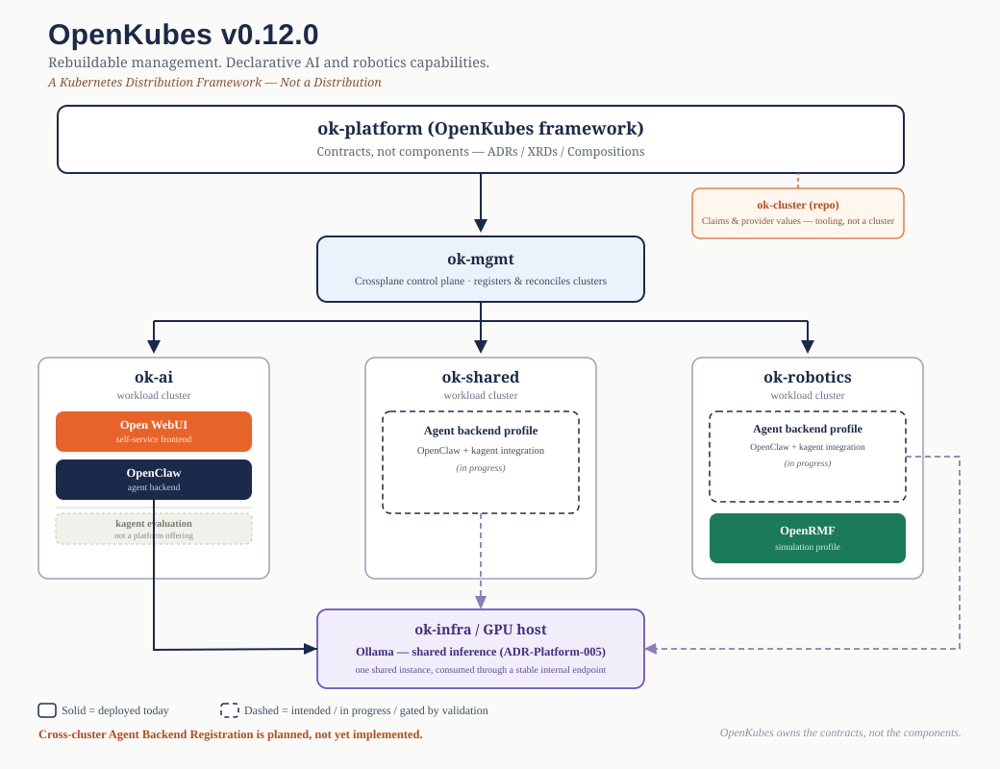

# OK-Cluster

**The OpenKubes Cluster Lifecycle Engine**

> **Runner credential-policy gate:** current v3/v4 live manifests, including the
> friendly-YAML runner handoff introduced in #450, cannot complete preparation
> or start Stage 1 until a reviewed bounded workload credential bootstrap exists.
> A platform handoff or renewed management/provider/ledger tokens do not bypass
> this gate. Static intent/Contract/plan preparation and the separately authorized
> existing teardown lifecycle remain available. See the
> [security contract](docs/ok147-security-review-contract.md).

OK-Cluster is the cluster lifecycle engine for [OpenKubes](https://github.com/openkubes/openkubes) — declarative creation, operation and upgrade of Kubernetes clusters across KubeVirt, bare metal, edge and cloud.

Powered by [Cluster API (CAPI)](https://cluster-api.sigs.k8s.io/), [CAPK (KubeVirt)](https://github.com/kubernetes-sigs/cluster-api-provider-kubevirt), [Talos Linux](https://www.talos.dev/), constrained [Flatcar](https://www.flatcar.org/), and [Ubuntu/kubeadm](https://kubernetes.io/docs/setup/production-environment/tools/kubeadm/).

---

## Start Here — OpenKubes Documentation

**New to OpenKubes?** Start with the website and choose the path that fits your environment.

| Resource | Where to start |
| --- | --- |
| **[Official Website & Documentation](https://openkubes.org/)** | OpenKubes overview, architecture and platform capabilities |
| **[Getting Started](https://openkubes.org/getting-started/)** | Choose OpenKubes Local, Cluster or AI |
| **[OpenKubes Framework Repository](https://github.com/openkubes/openkubes)** | Platform contracts, architecture decisions and shared integration layer |
| **[OK-Cluster documentation](docs/)** | Technical cluster lifecycle documentation maintained in this repository |

> **Cluster installation:** Follow the documented `ok-cluster` Makefile workflows below, with the required infrastructure and provider configuration. The emerging `ok` CLI is **not yet a generally supported one-command cluster installer**. Its current Bare-MVP flows need explicitly reviewed inputs and separate authorization for live execution.

---

## Platform Architecture (v0.12.0)



> A Kubernetes Distribution Framework — Not a Distribution. See [ADR-Platform-013](https://github.com/openkubes/openkubes/blob/main/architecture/decisions/ADR-Platform-013-workload-cluster-registration.md) (cluster registration) and [ADR-Platform-015](https://github.com/openkubes/openkubes/blob/main/architecture/decisions/ADR-Platform-015-agentic-ai.md) (agentic AI, multi-cluster addendum) for the underlying contracts.

---

## ✨ Features

- **HA Kubernetes in ~3 minutes** — 3 control planes + N workers, fully declarative
- **Three OS paths** — Talos, constrained Flatcar/amd64/KubeVirt, and Ubuntu
- **OS layer owned by [ok-linux](https://github.com/openkubes/ok-linux)** — Talos version and schematic ID are read from ok-linux profiles, not hardcoded here
- **Auto IP/CIDR allocation** — MetalLB IPs and pod/service CIDRs allocated automatically
- **Management plane registration** — `make register-cluster` wires any workload cluster into ok-mgmt/Crossplane per [ADR-Platform-013](https://github.com/openkubes/openkubes/blob/main/architecture/decisions/ADR-Platform-013-workload-cluster-registration.md)
- **Blue/Green upgrades** — rolling Kubernetes version upgrades with workload migration
- **GitOps-ready** — all cluster state is declarative YAML, rendered from templates
- **Single Makefile UX** — `make new`, `make install`, `make status`, `make upgrade`
- **Bounded Contract Executor MVP** — one shared Go core powers the local `ok` CLI and short-lived `ok-mgmt` Jobs across twelve bounded stages.

## `ok` CLI: Bare-MVP cluster creation

> **Status: active development / bounded Bare-MVP.** The CLI can be built, inspected and smoke-tested offline. `ok cluster create` currently depends on prepared, reviewed private manifests and policy/evidence inputs; live execution has independent authorization gates. **Do not treat the commands in this section as a production-ready quickstart or a general replacement for the existing Makefile workflows.** For the supported documentation entry point, see [Getting Started](https://openkubes.org/getting-started/).

Build the CLI locally and inspect its hierarchical help:

```bash
make ok-cli-build
.tools/bin/ok --help
.tools/bin/ok cluster --help
.tools/bin/ok cluster create --help
```

Run the self-contained offline smoke suite when no current private Bare-MVP
package is available:

```bash
make ok-cli-offline-smoke
```

It builds the binary and checks hierarchical and leaf help, product/legacy
routing, non-mutating dry-run and prepare boundaries, live double gates, exact
Stage-7 Bare-MVP completion and the legacy contract fixture. It creates no
cluster client and is not a substitute for validating a freshly rendered
private production manifest.

Client-certificate workload execution is **disabled** following the PR #430
security review. `--workload-kubeconfig-file` is retained for explicit rejection,
not as a supported continuation path. CAPI admin kubeconfigs are rejected before
credential-file reads or workload API contact. The lifecycle-derived materializer
also stops before reading the CAPI Secret. The existing separately supported
token paths retain their prior constraints; arbitrary bearer tokens are not
thereby certified as least privilege.

**Dependency: bounded workload credential bootstrap.** The default lifecycle-derived
Stage 1–7 path and downstream Stages 8–12 cannot complete until a reviewed issuer defines exact per-role
subjects, complete group allowlists, least-privilege RBAC and a justified maximum
certificate lifetime (or a separately approved bounded token bootstrap). The
executor must not use the CAPI admin credential to mint its own bounded access.
No numeric certificate TTL is inferred from CAPI's controller-admin lifetime or
from the separate TokenRequest policy.

`ok cluster stage resume` may inspect a stopped run's local receipt chain.
The narrow `ok147-network-profile-recovery/v1` binding and
`ok147-staged-execution-plan/recovery-v1` remain available for **offline artifact
consistency inspection only**. Both `--recovery-binding` and
`--recovery-binding-digest` are required. Original Stage 1–4 receipts retain their
bytes and source identity; only the corrected HRP-reference input may differ.
STOP fields and the exact `TERMINAL\n` marker content are checked, but these
operator-supplied artifacts do not authenticate source execution state. An
inspection result of `NEXT` is structural information, not execution permission.

**Recovery execution, grant-request preparation and authority-policy derivation
are disabled.** Stage 5–7 bundle loading and the underlying execution operations
reject recovery before opening capabilities. Stage-7 package/launch adapters retain
the recovery binding and reject it explicitly rather than emitting an unusable
Job with missing lineage. Shared resume flags are registered on additional expert
commands; their presence does not imply that recovery execution is supported.
No command or credential flag makes `cluster create --live` replayable.

**Dependency: atomic source-state reservation and legacy fencing.** Before recovery
can be enabled, source Stage-5 execution and recovery must share one authoritative
compare-and-swap gate. The gate binds the source execution, target, Stage-4 outcome
and one successor; per-stage claims prevent repeated Stage 5–7 work. Completed,
claimed, missing, unreadable or ambiguous source state must deny recovery.
A missing legacy gate is not an available slot. Existing executors and grants
must be fenced under a reviewed activation procedure; a new client-side check
cannot stop an old executable. Crashed reservations/claims remain indeterminate
without automatic release, expiry takeover or replay. This release implements the
disabled fallback, **not** that atomic protocol or its deployment.

See [the security follow-up contract](docs/ok147-security-review-contract.md).
ADR-030 security acceptance remains open. This workflow recovery does not implement
ADR-031 management-plane disaster recovery or authorize Talos `bootstrap-resume`.

The provider controller still needs valid infrastructure access after `ok` exits.
A completed receipt chain is not a guarantee of continuing availability after a
provider credential expires. The CLI does not automatically renew credentials or
replace immutable Secrets. See the [operator runbook](docs/ok147-operator-runbook.md#bare-mvp-closure-and-ongoing-provider-access)
for the distinction between recovered completion, current convergence and
ongoing credential ownership.

Renderer and packaging integrations can inspect the accepted input contract
without reading a private file:

```bash
.tools/bin/ok cluster create requirements
.tools/bin/ok cluster create manifest-template > /private/bare-run.template.json
.tools/bin/ok cluster create plan-template > /private/staged-plan.template.json
```

For a named run, create a new private workspace directly. The output directory
must not exist; the command refuses to reuse or overwrite it:

```bash
.tools/bin/ok cluster create scaffold \
  --name ok-cli-mvp \
  --output /private/ok-cli-mvp-run
```

This command is offline and create-only. It creates a `0700` directory with
`0600` Plan and manifest templates, reports `apiContacted: false` and
`mutationAllowed: false`, and still leaves all digest, endpoint and private
material placeholders invalid until authoritative inputs are supplied.
The scaffold is deliberately a first-run manifest v3 with Plan v1: a new
cluster has no consumed claim, predecessor attempt or stopped evidence.
Manifest v4 and Plan v2 remain accepted only for an explicitly reviewed
recovery attempt; do not invent recovery lineage for a fresh cluster.

After canonicalizing the reviewed Contract to obtain `R`, the repository
renderer can split an already rendered Talos/KubeVirt lifecycle into the two
authority planes expected by OK-147:

```bash
python3 render.py projection \
  --cluster ok-cli-mvp \
  --intent-revision sha256:<R> \
  --output /private/ok-cli-mvp-run/projection
```

Projection rendering is also offline, create-only and `NO-GO`. It refuses an
existing output directory and emits owner-only artifacts; it does not provide
credentials or authorization.

The templates contain the exact Stage 1-7 manifest shape, seven-stage Plan and
all sixteen ordered target-access identities. Placeholder digests, names,
hosts and paths are intentionally invalid, and the Plan remains explicitly
`NO-GO`. They are renderer input aids, not a runnable manifest or
authorization. Even a fully bound current manifest is rejected by the
credential gate; replacing placeholders does not enable execution. A legacy twelve-stage Plan remains accepted with Bare-MVP
for compatibility, but new Bare-MVP renderers should emit exactly seven.

The initial product surface consumes the private full-run manifest from the
proven OK-147 runner. It intentionally accepts only a manifest whose reviewed
Plan binds `completionMode: bare-cluster-mvp/v1`:

```bash
# Both commands currently return the explicit unsupported-credential error.
# They issue no grants and contact no API.
.tools/bin/ok cluster create --file /private/bare-run.json --dry-run

# No successful preparation receipt is emitted for this credential mode.
.tools/bin/ok cluster create --file /private/bare-run.json --prepare
```

Current private full-run manifests require an unsupported lifecycle-derived
certificate bootstrap. Consequently `--dry-run`, `--prepare` and `--live` fail
with an explicit credential-policy error **before Stage 1**, referenced
credential opening, grant resolution or API contact. No successful preparation
receipt or live execution identity is emitted for these manifests. Friendly YAML
intent validation/rendering and the separate legacy contract-only dry-run remain
offline surfaces; they do not establish executor readiness.

The default Stage 1–7 workflow cannot complete, and the same certificate gate
also blocks the downstream Stage 8–12 / PlatformReady workflow. This establishes
neither destroy as the only operational option nor permission to invent another
Plan or privileged bootstrap workaround. Preserve evidence and use separately
reviewed operational decisions.

Requirements/v1 remains wire-compatible, including its historical
`liveMutationAllowed: true` and seven-stage schema description. Requirements/v2
still adds only descriptive ownership metadata. Those static schema fields are
not a statement of current execution availability. Neither format bypasses the
manifest gate or grants authority. Full-run activation Job launch is also denied
before any API request; offline snapshots/packages are structural artifacts only.

The grant signer rejects **all Stage-7 / CreateTargetAccess requests**, including
ordinary and externally supplied legacy policies: their wire representation
cannot prove normal-versus-recovery provenance. This compatibility restriction
remains until authenticated Plan provenance and reviewed recovery fencing exist.
Already issued grants and old running signers are not revoked by new client
code; see the [remediation contract](docs/ok147-security-review-contract.md).

<details>
<summary><strong>Bounded Contract Executor MVP — technical details</strong></summary>

  The stage/library descriptions below retain the historical workflow model.
  They do not enable the blocked full-run create/launch paths or Stage-7 signing.
  The current execution gates and unresolved dependencies above take precedence.

  The legacy `cluster create --contract ... --dry-run` form remains
  non-mutating. The product `cluster create --file ...` facade verifies the
  Bare-MVP boundary before it can delegate to the staged runner, which models twelve
  predecessor-bound submission, observation,
  binding, credential and evaluation stages with a durable ledger, exact
  split authorities and no retry. The initial `cluster stage run --execute`
  path remains the separately authorized two-stage Contract-to-CAPI boundary.
  `cluster stage package` produces the
  digest-bound immutable ConfigMap/Job/NetworkPolicy envelope offline; the
  single-use Create-only installer can submit only that verified envelope
  after a complete zero-write preflight. Its tokenless runtime identity and
  two short-lived immutable credential Secrets are built as a separate
  private, digest-bound package and have their own single-use exact-create
  installer. TokenRequest issuance and live installation remain separately
  managed prerequisites. The shared runtime ServiceAccount also has a bounded
  exact-create-or-verify path and remains tokenless and RBAC-free. A unified
  non-mutating launch plan binds all six objects behind one complete preflight
  barrier and fixes their eventual create order without exposing object bodies
  or credentials. A single-use composite launcher implements the same order,
  verifies a complete exact duplicate as `ALREADY_LAUNCHED`, rejects every
  mixed partial state, preserves a redaction-safe receipt and has no update,
  delete, retry or rollback path. Its public opener additionally requires an
  exact, expiry-bound launch-candidate digest that binds destination, CA and
  installer credential evidence; preparing it remains non-mutating. Live
  invocation is still a separate critical boundary. A private launch-material
  builder now correlates all package, credential, runtime and candidate inputs
  without exposing their bytes or contacting Kubernetes. `ok cluster stage launch
  prepare` exposes only the redacted material/candidate receipts and rejects
  execution. A separate `ok cluster stage launch execute` boundary requires the
  exact prepared candidate, explicit `--execute`, bounded installer credentials
  and a single-use global-preflight launcher. The runner image is digest-pinned,
  multi-architecture, non-root, SBOM- and provenance-producing behind a
  protected publisher. `ok cluster stage resume` independently re-verifies an
  explicit canonical receipt prefix and reports only the next, completed or
  stopped cursor state; it has no grant, credential, endpoint or execution
  capability and can safely select the next read-only stage after a restart.
  Lifecycle/Network observation and runtime binding additionally permit one
  explicit retry only when the caller supplies the exact immutable terminal
  receipt digest. The first receipt remains unchanged and every different
  result is retained in a digest-addressed attempt slot. A generic receipt
  materializer can copy one independently selected successful ledger receipt
  to an absent private `0600` path without executing a stage.
  Successful Cluster-lifecycle submission also carries a SHA-256 binding of
  the exact CAPI Cluster UID through the durable outcome and stage receipt;
  the raw UID is not emitted in redaction-safe evidence. The next typed
  `lifecycle-observation` operation derives its target only from that receipt,
  performs bounded read-only CAPI polling and persists one immutable stage
  receipt. A restarted process reuses the persisted receipt without observing
  again; a same-name replacement Cluster fails the UID-digest boundary. A
  verified lifecycle-observation bundle now retains the plan and receipt
  cursor privately, opens distinct ledger and management-observer credentials
  exactly once and exposes only the bounded stage `Run` method. `ok cluster
  stage observe lifecycle --execute` is the first activation path: it accepts
  no grant or projection, requires an explicit receipt prefix and bounded
  polling window, reads only the exact CAPI Cluster and persists only its
  immutable stage receipt. `ok cluster stage observe lifecycle package`
  additionally creates a digest-bound immutable ConfigMap, NetworkPolicy and
  non-retrying Job envelope offline; it does not install or launch them. The
  matching `observe lifecycle launch prepare` command seals that package with
  two distinct short-lived Job credentials, the tokenless runtime identity and
  an expiry-bound installer candidate. Only `observe lifecycle launch execute`
  can open the installer credential and run the single-use six-object
  exact-create launcher; it requires the separately copied candidate digest
  and explicit `--execute`. The NetworkReady observation follows the same
  split boundary: `observe network launch prepare` correlates the immutable
  package, three distinct Job credentials, runtime identity and expiring
  installer candidate offline, while `observe network launch execute` alone
  can open the installer authority and invoke the seven-object, Job-last
  launcher. It also requires the exact candidate digest and explicit
  `--execute`. The following `runtime-binding` stage now has a separate
  crash-safe local operation as well: it accepts only the exact runner-owned
  cursor, invokes one prebound binder and persists an immutable receipt before
  any later target-access stage can open. Its offline materializer now binds
  the private target endpoint, CA and raw runtime UIDs to the five-receipt
  prefix while exposing only digest identities publicly. A bounded source now
  performs only the exact `kube-system` and `local-path` GETs after proving the
  workload authority. Talos KubeVirt lifecycle artifacts bootstrap the exact
  `local-path` identity from a vendored, digest-pinned inline manifest, so this
  prerequisite is part of the staged plan rather than a manual post-create
  mutation. An exclusive private writer creates and verifies one
  `0600` binding file without overwrite or cleanup. These capabilities are now
  composed with the runner-owned crash-safe stage operation and immutable
  ledger receipt. `ok cluster stage bind runtime --execute` is the first local,
  two-minute activation boundary and emits only its redaction-safe evidence;
  Job activation and all target access remain separate. A Job-suitable store
  candidate can create or verify one exact immutable runtime-binding Secret on
  `ok-mgmt`; it has no update/delete/retry path. A distinct library opener now
  composes that store with pairwise-separate ledger, persistence and workload
  credentials. The CLI activates it only with explicit `--execute` plus
  `--persistence-mode immutable-secret`; no Job package activates it yet. Its
  offline immutable input ConfigMap now binds only the public plan and exact
  five-receipt prefix, excluding all private authority and credential data. A
  matching offline Job/NetworkPolicy envelope fixes three distinct credential
  mounts and only the exact management and workload API egress destinations;
  the ConfigMap and envelope are now correlated under one verified package
  digest. That package is also bound to the shared tokenless runtime
  ServiceAccount. Three independently issued short-lived credentials are now
  sealed offline into private immutable Secrets for ledger write, binding
  persistence and workload observation; only the redacted credential receipt
  is public. `ok cluster stage bind runtime launch prepare` now reconstructs
  those inputs and emits only the redacted material and candidate receipts
  without API contact. `ok cluster stage bind runtime launch execute` is the
  sole CLI path to the single-use, seven-object, create-only launcher; it
  requires the separately copied candidate digest, bounded installer files and
  explicit `--execute`. It completes all exact-name GETs before its first POST,
  creates the Job last, and has no update, patch, delete, list, watch or retry
  path. The boundary is covered only by local and fake-API tests at this
  checkpoint; no DEV runtime-binding Job has been launched.
  The next `target-access` stage now starts with a separate offline verifier
  for one externally rendered eleven-object workload RBAC set. It binds the
  artifact to `R`, `P`, the execution fixture and immutable target identity,
  fixes object order and REST routes, rejects wildcard/non-resource access,
  foreign subjects and runtime metadata, and returns only a non-authorizing
  plan. A runner-owned offline bundle now additionally requires the exact six
  successful predecessor receipts, durable lifecycle target identity and a
  signed `CreateTargetAccess` grant before exposing a redacted verified bundle
  receipt. A typed runtime opener now correlates the private raw CAPI UID with
  that public target digest, requires distinct ledger and short-lived workload
  credentials, and preconstructs exactly one eleven-object create-only mutator.
  Opening performs no API request or grant claim; only the returned crash-safe
  staged operation can claim and submit. The local
  `ok cluster stage run target-access --execute` boundary now requires the
  exact six-receipt prefix, signed grant, eleven independently named object
  identities, private runtime-binding digest and distinct ledger/workload
  files before it can invoke that operation. A separated TLS fake-API proof
  covers the complete claim-to-submit path: exactly eleven ordered
  `GET`/conditional-`POST` pairs, durable success replay without another write,
  and a durably stopped partial prefix without retry. Its first Job-package
  boundary is offline: one immutable ConfigMap binds the plan,
  signed grant, exact six-receipt prefix and eleven-object artifact while
  excluding the private runtime binding, CA and both credentials. A hardened
  NetworkPolicy and non-retrying Job bind only the exact management-ledger and
  workload API endpoints. Two distinct short-lived immutable Secrets carry the
  ledger and workload writer credentials; only the workload Secret carries the
  runtime-bound target identity. The shared tokenless runtime, three public
  objects and both private Secrets are sealed behind one six-object global
  preflight. The Job is created last, a complete exact duplicate is
  `ALREADY_LAUNCHED`, and every other partial state stops with zero writes.
  `ok cluster stage run target-access package` emits only a new local `0600`
  package, `... launch prepare` emits redacted material/candidate receipts, and
  only `... launch execute --execute` can open the exact expiry-bound installer
  candidate. These activation paths are covered by local and fake-API tests;
  no DEV Target Access Job has been launched by the MVP.
  The last three workload objects are a separate tokenless autonomy-observer
  ServiceAccount, an exact read-only Role (`get` Services and `list`
  EndpointSlices), and its RoleBinding. They are not shared with Argo CD and
  cannot write workload resources.
  After runtime binding, an offline collector-activation builder can package
  that exact observer identity into one immutable private Secret together with
  separate webhook/query authorities, a short-lived observer token, pinned
  workload CA and TLS key pair. Its public receipt exposes only correlated
  digests. `ok cluster stage evidence observability collector package` now
  composes that Secret with one LoadBalancer Service, exact NetworkPolicy and
  time-limited non-retrying Job; the init-only materializer and activation-only
  serve path keep projected secrets private. These offline steps perform no
  cluster request or mutation; publishing and launching the fresh package
  remain separate gates.
  Stage 4 now has its first distinct path as well:
  `ok cluster stage run enablement --execute` binds the verified three-receipt
  prefix and signed `CreateEnablement` grant to exactly one externally rendered
  `HelmChartProxy`; it neither renders Helm nor writes the controller-owned
  `HelmReleaseProxy`. A distinct offline package now composes the immutable
  eight-key input ConfigMap with a tokenless, non-retrying Job and a deny-all
  NetworkPolicy that permits only the exact management API endpoint. The
  package is emitted locally with `ok cluster stage run enablement package`.
  A private offline credential packager separately verifies two distinct,
  short-lived management TokenRequest results for ledger and HCP writer roles;
  its public receipt exposes neither tokens, CA data, subjects nor paths. The
  shared tokenless runtime ServiceAccount is also bound offline to the exact
  Enablement package and contains no RBAC or implicit Pod credential. A
  read-only installation planner finally derives the fixed ConfigMap,
  NetworkPolicy, Job GET/POST sequence without opening either credential. A
  private launch planner correlates runtime, prerequisites, both Secrets and
  the final Job behind one global six-object preflight barrier. A prepared,
  expiry-bound candidate then binds that plan to one exact management API,
  CA, installer-token identity and independent credential evidence. These
  public and private inputs can now be sealed as one verified launch material.
  The material can open only its exact retained candidate. A single-use Enablement
  launcher now proves the six-GET global barrier and fixed six-POST create-only
  sequence against a fake API. `ok cluster stage run enablement launch prepare`
  emits the redaction-safe sealed-material and candidate receipts. The separate
  `... launch execute --execute` boundary requires that exact candidate digest
  plus the bounded installer files before it can open the single-use launcher.
  The complete Stage 8-12 suffix is also available through a local
  `post-runtime prepare`/`execute` pair and a bounded ephemeral Job. A private
  immutable 34-file activation Secret, exact NetworkPolicy and non-retrying
  Job are correlated under one package digest. `post-runtime launch prepare`
  emits only their redacted package receipt and exact create plan;
  `post-runtime launch execute --execute` requires that package digest and a
  bounded `ok-mgmt` installer credential, completes three exact-name GETs
  before any write, then can create only Secret, NetworkPolicy and Job in that
  order. This complete Job path is tested offline and against fake APIs but is
  not yet live-proven on DEV. If the process loses its memory-only target
  credential after a durable successful Stage-8 receipt, the library now
  supports an explicit receipt-bound continuation: a separately signed grant
  with a new GrantID is claimed once in the existing ledger before a new
  TokenRequest. The original Stage-8 receipt remains unchanged and automatic
  mutation retry is still prohibited. A package-private registration refresh
  primitive additionally verifies the complete existing AppProject and static
  cluster-Secret binding before one UID/resourceVersion-protected token update;
  it remains unusable until a separate Stage-9 recovery grant and ledger claim
  are composed around it.

</details>

---

## Prerequisites

- A Kubernetes host cluster with:
  - [KubeVirt](https://kubevirt.io/) — VM runtime
  - [CDI](https://github.com/kubevirt/containerized-data-importer) — disk image importer
  - [MetalLB](https://metallb.universe.tf/) — LoadBalancer IP pool
  - [local-path-provisioner](https://github.com/rancher/local-path-provisioner) — PVC storage
  - [CAPI](https://cluster-api.sigs.k8s.io/) + [CAPK](https://github.com/kubernetes-sigs/cluster-api-provider-kubevirt) — cluster lifecycle
  - Talos Bootstrap Provider (`cacppt`) — for Talos clusters
- Tools: `clusterctl`, `helm`, `talosctl`, `kubectl`, `python3`, `make`
- Kubeconfig at `~/.kube/<host-cluster>.yaml`
- **For Talos and Flatcar clusters:** a sibling checkout of [ok-linux](https://github.com/openkubes/ok-linux) (see [OS Layer Integration](#os-layer-integration) below)
- **For Talos and constrained Flatcar:** Python 3 with HTTPS access to
  `helm.cilium.io`, or a pre-downloaded Cilium 1.19.6 chart for offline
  acquisition. Flatcar additionally requires an explicit management
  kubeconfig.

> See [OpenKubes Infrastructure](https://github.com/openkubes/openkubes/tree/main/platform/infrastructure) for host cluster setup.

---

## Quick Start

### Talos Cluster (recommended)

```bash
# Acquire once, before measuring provisioning time. A valid cache is reused.
make prepare-cilium-chart

# Scaffold a new HA Talos cluster
# Talos version and schematic ID are read from ../ok-linux automatically
make new CLUSTER=my-cluster TYPE=talos WORKERS=2

# Deploy (applies CAPI manifests, annotates PVCs, bootstraps Talos)
make bootstrap CLUSTER=my-cluster

# Get kubeconfig once nodes are Running
make kubeconfig CLUSTER=my-cluster

# If bootstrap was interrupted in a supported post-apply state, resume it
# (annotate PVCs, kubeconfig, Cilium, wait for Ready) without re-applying:
make bootstrap-resume CLUSTER=my-cluster

# Check status
make status CLUSTER=my-cluster

# Install workload-cluster storage, then observability (observability is GATED:
# the command fails unless the Contract Test Gate passes — see below)
make install-storage       CLUSTER=my-cluster
make install-observability CLUSTER=my-cluster

# Optional: register with the ok-mgmt management plane (Crossplane)
make register-cluster CLUSTER=my-cluster
```

#### Kubeconfig locations

The Talos lifecycle targets (`new`, `render`, `bootstrap`, `bootstrap-resume`,
`annotate-pvcs`, `kubeconfig`, `install-cni`, `teardown`) take the
management-cluster kubeconfig from `TALOS_INFRA_KUBECONFIG` and write the guest
kubeconfig to `GUEST_KUBECONFIG_DIR/<cluster>.yaml`. Both default to `~/.kube`
(`~/.kube/ok-infra.yaml`, `~/.kube/<cluster>.yaml`); override them together to
keep a run self-contained:

```bash
make bootstrap CLUSTER=my-cluster \
  TALOS_INFRA_KUBECONFIG=/path/to/ok-infra.yaml \
  GUEST_KUBECONFIG_DIR=/path/to/kubeconfigs
```

`make kubeconfig` writes the file atomically with mode `0600` and prints the
`clusterctl` error instead of leaving an empty file behind.

`make bootstrap-resume` is only for a cluster whose rendered manifests were
already applied and whose bootstrap did not finish. Before continuing, it
compares the live CAPI Cluster's name, namespace, rendered labels, object
references, and cluster-network fields with `cluster-base.yaml`. It refuses a
paused or deleting Cluster, a failed or otherwise unsupported lifecycle phase,
and any live object that differs from the render. Supported recovery states are
an applied Cluster with an empty or `Pending` phase still awaiting its
controllers, or a `Provisioning` or `Provisioned` Cluster for which the guest kubeconfig or CNI is not yet
available, or one or more guest nodes are still `NotReady`. The target does not
apply manifests or repeat the Golden Image preflight.

#### Talos teardown ledger operational contract

`ok-cluster` owns the durable Talos teardown ledger, including its namespace,
RBAC manifest, record formats and admin lifecycle. Record schemas `1` and `2`
store one ConfigMap per consumer cluster in namespace `ok-cluster-teardown`.
Schema `1` records a single-plane teardown. Schema `2` adds the management and
provider plane identities and provider storage provenance required by a
split-plane teardown. The exact ConfigMap name is
`ok-cluster-teardown-<cluster>` and it has these labels:

```yaml
app.kubernetes.io/managed-by: ok-cluster
openkubes.io/consumer-cluster: <cluster>
```

The sole payload is `data["record.json"]`. It binds the cluster name, Golden
Image namespace and claim, OS identity and image digest, the original Cluster
and Namespace UIDs, exact observed DataVolume UIDs, Retain-policy PV names and
completion state. Schema `2` additionally binds both planes by the UID of their
`kube-system` Namespace, the provider workload Namespace UID and the provider
storage UIDs. It contains no credentials. A record with a version other than
`1` or `2` fails with an unsupported-schema diagnostic. A missing payload,
malformed JSON, extra or missing field, invalid identity, invalid inventory or
invalid completion marker is refused.

The `openkubes.io/teardown-ledger-schema: "1"` annotation on the Namespace and
RBAC objects versions the owned namespace layout. It does not declare or limit
the `record.json` schema; that namespace stores both supported record schemas.

Install the namespace and roles once on the management plane with an
administrative management identity:

```bash
make install-teardown-ledger \
  TALOS_INFRA_KUBECONFIG=/path/to/management.yaml \
  CONFIRM=yes
```

The target applies `deploy/talos-teardown-ledger.yaml` and fails closed unless
`CONFIRM=yes` is supplied literally. The namespaced Role grants only `get`,
`create` and `patch` on ConfigMaps. `patch` is required because teardown
advances the same receipt under its `resourceVersion`; `update`, `delete`,
`list` and `watch` are not lifecycle authority. A separate ClusterRole grants
only `get` on the exact Namespace resources named `ok-cluster-teardown` and
`kube-system`. The first bounded read lets lifecycle distinguish an absent or
unreadable ledger namespace from a missing per-cluster ConfigMap. The second
lets split-plane teardown bind each API plane to the UID of its `kube-system`
Namespace. It grants no Namespace creation and no access to ConfigMaps,
Secrets or any other namespaced contents in either Namespace.

Bind both roles to the identity carried by `TALOS_INFRA_KUBECONFIG`. For a user
credential, the matching templates are:

```yaml
apiVersion: rbac.authorization.k8s.io/v1
kind: RoleBinding
metadata:
  name: ok-cluster-teardown-ledger
  namespace: ok-cluster-teardown
roleRef:
  apiGroup: rbac.authorization.k8s.io
  kind: Role
  name: ok-cluster-teardown-ledger
subjects:
  - apiGroup: rbac.authorization.k8s.io
    kind: User
    name: "<teardown-principal>"
---
apiVersion: rbac.authorization.k8s.io/v1
kind: ClusterRoleBinding
metadata:
  name: ok-cluster-teardown-namespace-reader
roleRef:
  apiGroup: rbac.authorization.k8s.io
  kind: ClusterRole
  name: ok-cluster-teardown-namespace-reader
subjects:
  - apiGroup: rbac.authorization.k8s.io
    kind: User
    name: "<teardown-principal>"
```

Use a ServiceAccount subject instead when the kubeconfig authenticates as a
ServiceAccount. The bindings are deliberately operator-specific and therefore
are templates rather than objects installed by the shared manifest.
For split-plane teardown, bind this Namespace-reader ClusterRole to the
management-plane identity. Install the separate provider reader on the provider
plane, then bind its `ok-cluster-teardown-provider-namespace-reader` ClusterRole
to the provider-plane identity. Both roles grant the same exact-name `get` for
the `kube-system` Namespace object so lifecycle can bind the plane UID; neither
grants access to `kube-system` contents. Bind the namespaced ledger Role only on
the management plane, where the durable ConfigMap lives.

```bash
make install-teardown-provider-reader \
  TALOS_TEARDOWN_PROVIDER_KUBECONFIG=/path/to/provider.yaml \
  CONFIRM=yes
```

After the approved split teardown and any required verification, remove that
provider-plane ClusterRole with the same explicit kubeconfig and confirmation:

```bash
make remove-teardown-provider-reader \
  TALOS_TEARDOWN_PROVIDER_KUBECONFIG=/path/to/provider.yaml \
  CONFIRM=yes
```

Removal first inventories every ClusterRoleBinding and every namespaced
RoleBinding on the provider plane. It refuses while any binding refers to
`ok-cluster-teardown-provider-namespace-reader`, naming each blocking binding,
and fails closed if either inventory cannot be read. Remove those bindings
through their separately reviewed lifecycle before retrying the ClusterRole
removal.

`make teardown` checks the exact ledger Namespace before reading a receipt or
deleting anything. If the Namespace is absent or unreadable, it fails with a
diagnostic naming `ok-cluster-teardown` and the
`make install-teardown-ledger TALOS_INFRA_KUBECONFIG=<path> CONFIRM=yes`
recovery target. It then creates
or patches a schema-1 (single-plane) or schema-2 (split-plane) record before deletion. An unavailable or unreadable
record fails closed. An incomplete entry refuses a same-name Cluster or
Namespace with a different UID. A completed receipt returns idempotently when
both resources remain absent. If the cluster name has been reused and the live
UIDs differ, the next authorized teardown supersedes the completed receipt
with the recreated resources' identities using a resourceVersion-guarded
patch; an incomplete receipt never authorizes that reuse.

Deletes bind to the verified UID on the API server; RBAC and snapshot deletes
also bind to the resource version whose ownership was checked. Deletion waits
up to ten minutes per resource for absence; a timeout leaves the entry
incomplete. After foreground Cluster deletion, teardown merges final
DataVolume and PV identities before deleting the workload Namespace. Retained
volume and Golden clone cleanup runs only after both the CAPI Cluster and its
Namespace are verified absent. Failures keep the incomplete receipt and local
render directory for a retry. Only explicit `NotFound` counts as absence.

Only the separate admin migration target reads legacy schema-1 or schema-2 receipts in
`kube-system`; ordinary teardown never falls back to that namespace for a
receipt and never reads its ConfigMaps. Split-plane teardown separately reads
only the `kube-system` Namespace object on each plane to bind the plane UIDs.
Move a legacy receipt into the owned namespace with the guarded admin operation:

```bash
make migrate-teardown-ledger \
  CLUSTER=<cluster> \
  TALOS_INFRA_KUBECONFIG=/path/to/management.yaml \
  CONFIRM=yes
```

Migration validates the legacy record, copies `record.json` byte for byte,
reads the destination back and verifies the exact bytes before deleting the
legacy ConfigMap. Re-running after a successful migration is idempotent. An
existing destination with different bytes is a conflict and neither record is
changed or deleted.

Completed receipts are retained by default. Pruning is a separate admin action
that needs ConfigMap `delete` authority outside the lifecycle Role. For a
schema-1 receipt, it succeeds only when the receipt is valid and complete and
both the CAPI Cluster and workload Namespace are absent. An incomplete receipt
is never pruned:

```bash
make prune-teardown-ledger \
  CLUSTER=<cluster> \
  TALOS_INFRA_KUBECONFIG=/path/to/management.yaml \
  CONFIRM=yes
```

The current prune command refuses schema-2 receipts because its management
kubeconfig cannot prove provider-plane absence. Retain the completed receipt by
default. If policy requires its removal, an administrator must first verify the
recorded provider Namespace and storage objects are absent on the recorded
provider plane, then manually delete the exact ConfigMap with UID and
`resourceVersion` preconditions. Do not treat management-plane absence alone as
proof that a split-plane receipt is safe to remove.

#### Disposable split-plane proof (OK-197)

The coordinator runs `tests/live/ok197_split_plane_proof.py`; its offline
companion is `make ok197-split-plane-proof-test`. Use Linux, Python/PyYAML,
kubectl, Helm, an `OK_LINUX_PATH` checkout matching the Golden image, and the
pinned Cilium chart (`make prepare-cilium-chart`). The explicit administrative
kubeconfigs need ServiceAccount TokenRequest, RBAC binding, guest provisioning
and impersonation authority. The helper never uses their credentials in CAPK's
external-infra Secret or in the teardown identities.

```bash
export CLUSTER=ok197-split-ab12
export MGMT_KUBECONFIG=/private/management.yaml
export INFRA_KUBECONFIG=/private/provider.yaml
export OK197_EVIDENCE_DIR=/private/evidence/ok197-split-ab12
export OK_LINUX_PATH=/mnt/d/kubernauts/temp/kubernauts/ok/ok-linux
export CILIUM_CHART="$(pwd)/.tools/cilium-1.19.6.tgz"
make prepare-cilium-chart
python3 tests/live/ok197_split_plane_proof.py preflight
OK197_SPLIT_CONFIRM=yes python3 tests/live/ok197_split_plane_proof.py create
OK197_SPLIT_CONFIRM=yes python3 tests/live/ok197_split_plane_proof.py teardown
python3 tests/live/ok197_split_plane_proof.py verify
OK197_SPLIT_CONFIRM=yes python3 tests/live/ok197_split_plane_proof.py cleanup-check
```

Use a fresh name and evidence directory. Evidence must be outside this repo;
each command writes a timestamped transcript and JSON summary, including on
guard failure. `preflight` records `ok-cli-mvp-3` names/UIDs on both planes;
`cleanup-check` compares them and, with confirmation, removes proof identities and bindings
using UID preconditions. Interrupted creates retain tracked resources: retry
`cleanup-check` before CAPI submission, or `teardown` after submission. A failed
teardown retains its receipt and local render for retry. The completed receipt,
local render and shared ledger/reader installations remain for operator review.

`create` installs the ledger on management first and the separate Namespace
reader on provider, then uses `make new`/`render` with `infraClusterSecretRef`.
It prints the complete kind-based split before guest writes: the guest Namespace
exists on both planes; CAPI `Cluster`, `KubevirtCluster`,
`KubevirtMachineTemplate`, `TalosControlPlane`, `TalosConfigTemplate` and
`MachineDeployment` go to management; Golden Role/RoleBinding and KubeVirt/CDI
runtime objects go to provider. Unknown kinds fail closed. CAPK creates the VMs
and DataVolumes through the external-infra credential.

The immutable Opaque Secret uses key `kubeconfig`, the static bearer-token shape
accepted by `internal/submission/provider_access.go`. Its fresh four-hour
ServiceAccount token is bound to the exact provider lifecycle Role emitted by
`render.py projection`, scoped to this guest namespace. The issued token must
have 210–241 minutes remaining before the helper submits the Secret. Secret
creation is one atomic CREATE; an `AlreadyExists` response stops the run without
prefetching the existing Secret. Complete the disposable run promptly within
that lifetime; this helper supplies no credential renewal. The actual token
expiry is saved without the token. The post-Ready path retains a 30-minute
floor; teardown requires that floor only while the recorded management Cluster
UID still exists. An expired interrupted guest needs coordinator credential
recovery when that Cluster remains. Teardown
uses separate fresh tokens bound to the shipped ledger/Namespace-reader roles
and printed extra teardown rules. Shared-storage deletes are restricted to
captured PV/Longhorn/snapshot names; guest inventory Roles disappear with the
guest namespace and are checked as revoked afterward. Credentials live in memory, including the
guest kubeconfig used by the existing CNI install and node Ready gate.

`teardown` proves provider plane binding fails with HTTP 403 when the reader is
unbound, before any mutation. It then exercises split teardown, completed-receipt
retry, and schema-2 prune refusal. Sanitized `kubectl -v=6` traces assert exactly
one `kube-system` Namespace GET per plane; server-side impersonated `auth can-i`
checks cover granted verbs and forbidden ledger/`kube-system`/Namespace access.
`cleanup-check` checks guest objects, saved PV/Longhorn names, Golden RBAC and
owned snapshots. Legacy migration is outside this proof's scope.

The ledger is also the safety boundary after destructive deletion. Clone
authorization cannot be removed before the workload Namespace because live CDI
clones may still require it. After DataVolumes are deleted, their UIDs cannot
be reconstructed safely from snapshots alone. If both local render and durable
record are missing, teardown refuses to infer ownership. Snapshot deletion
requires a saved DataVolume UID, the CDI label and the expected Golden PVC
source.

For troubleshooting, use an administrative read credential and preserve raw
errors:

```bash
kubectl --kubeconfig /path/to/management.yaml get namespace ok-cluster-teardown
kubectl --kubeconfig /path/to/management.yaml \
  -n ok-cluster-teardown get configmap ok-cluster-teardown-<cluster> -o yaml
kubectl --kubeconfig /path/to/management.yaml \
  -n ok-cluster-teardown get configmaps \
  -l app.kubernetes.io/managed-by=ok-cluster
kubectl --kubeconfig /path/to/management.yaml \
  -n kube-system get configmap ok-cluster-teardown-<cluster> -o yaml
kubectl --kubeconfig /path/to/management.yaml \
  get namespace kube-system -o jsonpath='{.metadata.uid}{"\\n"}'
kubectl --kubeconfig /path/to/provider.yaml \
  get namespace kube-system -o jsonpath='{.metadata.uid}{"\\n"}'
```

An absent or forbidden Namespace requires the install/binding repair before
teardown. A malformed or unsupported record requires operator investigation;
do not overwrite it. A migration conflict means the two byte streams differ;
retain both and resolve their provenance. A forbidden `kube-system` Namespace
read means the corresponding management or provider identity lacks the exact
Namespace `get`; granting ConfigMap or Secret access there is neither required
nor an acceptable repair. A prune refusal means the receipt is incomplete, a
live Cluster or Namespace still exists, provider-plane absence is unproven for
schema `2`, or another absence check could not be completed.
Completed split-plane receipts are retained by prune unless provider-plane
absence is proven; remove them by hand with admin rights after verification,
using the preconditions described above.

#### Reviewed Talos KubeVirt scheduling profiles

Ordinary Talos clusters default to the existing production profile
`ok-infra`. To place both control-plane and worker VMs on `ok-gpu`, select the
reviewed provider profile explicitly:

```bash
make new \
  CLUSTER=ok-iot \
  TYPE=talos \
  SCHEDULING_PROFILE=ok-gpu \
  CP_CORES=2 \
  CP_MEMORY=4Gi \
  CP_DISK=20Gi \
  WORKER_CORES=4 \
  WORKER_MEMORY=8Gi \
  WORKER_DISK=30Gi

make talos-golden-preflight \
  CLUSTER=ok-iot \
  TALOS_INFRA_KUBECONFIG="$HOME/.kube/ok-infra.yaml"

make bootstrap \
  CLUSTER=ok-iot \
  TALOS_INFRA_KUBECONFIG="$HOME/.kube/ok-infra.yaml" \
  CILIUM_CHART="$(pwd)/.tools/cilium-1.19.6.tgz"
```

Both `ok-infra` and `ok-gpu` use the stable, replicated
`ok-storage-block` contract and the same immutable Talos Golden Image. CPU,
memory and disk sizes remain independently configurable for control-plane and
worker VMs. The read-only preflight checks the selected node's remaining
compute capacity, two-replica Longhorn capacity, KubeVirt disk expansion and
the CDI snapshot-clone path before bootstrap.

Free-form Talos KubeVirt placement fails closed. For example,
`NODE_SELECTOR=ok-gpu` without `SCHEDULING_PROFILE=ok-gpu`, a mismatched node,
an arbitrary StorageClass or an unknown profile is rejected before rendering.
The historical `gpu-single-replica` meetup profile and
`ok-storage-block-gpu-test` remain demonstration-only and are not production
fallbacks.

For local development and disposable demonstrations, the explicit
`ok-gpu-single-replica` profile selects that isolated StorageClass without
weakening either production profile:

```bash
make new \
  CLUSTER=ok-iot \
  TYPE=talos \
  SCHEDULING_PROFILE=ok-gpu-single-replica \
  WORKERS=3 \
  CP_CORES=2 CP_MEMORY=4Gi CP_DISK=20Gi \
  WORKER_CORES=2 WORKER_MEMORY=4Gi WORKER_DISK=30Gi
```

This profile places every VM and its single boot-volume replica on `ok-gpu`.
It provides no node or disk failure tolerance and must not be presented as the
stable `ok-storage-block` contract.

### Ubuntu Cluster

```bash
# Scaffold a new HA Ubuntu cluster
make new CLUSTER=my-cluster TYPE=ubuntu HA=true WORKERS=2

# Deploy (applies manifests, waits for control plane, installs Cilium)
make install CLUSTER=my-cluster

# Get kubeconfig
make kubeconfig CLUSTER=my-cluster
```

### Constrained Flatcar Cluster

Flatcar is supported only inside the exact ADR-009 envelope: stable 4593.2.4,
amd64, KubeVirt, Kubernetes v1.34.1, one control-plane and one worker. There is
no fallback and unsupported overrides fail before rendering.

```bash
# Online acquisition from the authoritative Helm repository:
make prepare-cilium-chart

# Or offline/pre-downloaded acquisition:
make prepare-cilium-chart \
  CILIUM_CHART_SOURCE=/media/artifacts/cilium-1.19.6.tgz

# Both commands atomically publish the verified chart here:
#   $(pwd)/.tools/cilium-1.19.6.tgz

make new CLUSTER=my-flatcar TYPE=flatcar

make flatcar-preflight \
  CLUSTER=my-flatcar \
  FLATCAR_INFRA_KUBECONFIG=/path/to/ok-infra.yaml \
  FLATCAR_CILIUM_CHART="$(pwd)/.tools/cilium-1.19.6.tgz"

make install-flatcar \
  CLUSTER=my-flatcar \
  FLATCAR_INFRA_KUBECONFIG=/path/to/ok-infra.yaml \
  FLATCAR_CILIUM_CHART="$(pwd)/.tools/cilium-1.19.6.tgz" \
  FLATCAR_APPLY=yes
```

`prepare-cilium-chart` downloads only
`https://helm.cilium.io/cilium-1.19.6.tgz` and requires SHA-256
`21c43cf53841f9ab0375047d95aa4c64051ea52bbd2c679416e6408f5f1c9179`.
The `.tools/` cache is git-ignored. A valid cached file is reused without
network access; an invalid cache or pre-downloaded file fails closed and is
never silently replaced. Move an invalid cached file aside before deliberately
acquiring it again. `make verify-cilium-chart` performs verification only and
never downloads.

The guarded installer requires clean, pushed `ok-linux` and `ok-cluster`
commits, verifies the exact CAPI/CABPK/KCP 1.13.3, CAPK 0.11.2, KubeVirt 1.8.1
management envelope plus the Ignition gates and golden-image identity, and uses
the digest-bound local Cilium 1.19.6 chart without a public artifact fetch.
Generic `install`, `bootstrap`, `install-cni`, `upgrade`, `clean`, and
`teardown` targets refuse Flatcar.

#### Verified runtime: `ok-flatcar` (2026-07-30)

The historical
[`ok-flatcar/cluster-config.yaml`](https://github.com/openkubes/ok-cluster/blob/dcbc706f4b027743d765cedd8848d5e1837b2a1f/ok-flatcar/cluster-config.yaml)
was the first ordinary deployment of the production-constrained profile. It
was reviewed in [PR #18](https://github.com/openkubes/ok-cluster/pull/18) and
merged as `dcbc706`. The guarded install completed in an observed 3m13s; this
duration is evidence from that run, not an availability or provisioning-time
SLO. The disposable cluster was subsequently torn down and its active
declaration removed after verification.

| Signal | Verified result |
|---|---|
| CAPI Cluster | `Provisioned`, `Available=True` |
| Topology | one control-plane and one worker |
| Nodes | 2/2 `Ready` |
| OS | Flatcar Container Linux 4593.2.4 (Oklo), amd64 |
| Kubernetes | kubelet v1.34.1 |
| Provider identity | both ProviderIDs start with `kubevirt://` |
| Cilium | DaemonSet 2/2 available, operator 1/1 available |
| Lifecycle | Secret-backed Ignition; replacement-only; no SSH authority |

The post-install checks were recorded with explicit kubeconfig paths:

```bash
kubectl --kubeconfig ~/.kube/ok-flatcar.yaml get nodes
kubectl --kubeconfig ~/.kube/ok-flatcar.yaml get pods -A
kubectl --kubeconfig ~/.kube/ok-infra.yaml \
  -n ok-flatcar get cluster ok-flatcar
```

Keep workload and management kubeconfigs under `~/.kube/`. Do not copy them
into the repository, and prefer explicit `--kubeconfig` arguments over a
long-lived `KUBECONFIG` export when recording operational evidence.

---

## Management Plane Registration (ADR-Platform-013)

To let Crossplane on the management cluster (ok-mgmt) deploy into a workload cluster, the cluster must be **registered**: a kubeconfig secret `<cluster>-kubeconfig` in `crossplane-system` plus a same-named provider-helm `ProviderConfig`. The cluster name is the single join key — Compositions target the cluster via `providerConfigRef.name: <cluster>`.

```bash
# Standard case: kubeconfig at ~/.kube/<cluster>.yaml (written by make bootstrap)
make register-cluster CLUSTER=ok-ai

# Externally provided kubeconfig (e.g. handed over by another cluster owner)
make register-cluster CLUSTER=ok2-rmf KUBECONFIG_SRC=~/incoming/ok2-rmf.yaml
```

The target validates the source kubeconfig first (fail fast) and uses **replace semantics** — the same command handles first registration and re-registration. **Re-run it after every re-bootstrap of the cluster** (cluster owner's responsibility); this retires the stale-secret trap.

Registration is deliberately **not** part of `make bootstrap`: bootstrap acts on the workload cluster, registration writes to the management plane — two different trust boundaries.

Deregistration is the explicit counterpart (OK-62). After `make teardown`, the kubeconfig secret and ProviderConfig remain orphaned in ok-mgmt by design — remove them with:

```bash
make unregister-cluster CLUSTER=ok1-talos
```

The target refuses if Releases still reference `providerConfigRef.name: <cluster>` (deleting the ProviderConfig under active Releases leaves Crossplane unable to reconcile or uninstall them) — delete the claims first, or override with `FORCE=true` (Crossplane usage protection then keeps the ProviderConfig in Terminating until all Releases are gone). Idempotent; deliberately **not** part of `make teardown` — same trust-boundary argument as registration.

> Contract: [ADR-Platform-013 — Workload cluster registration contract](https://github.com/openkubes/openkubes/blob/main/architecture/decisions/ADR-Platform-013-workload-cluster-registration.md). The Make target is its non-normative reference implementation.

---

## OS Layer Integration

ok-cluster does not own OS identity or verified image inputs.
**[ok-linux](https://github.com/openkubes/ok-linux) is the source of truth.**

```
ok-linux/profiles/kubevirt/profile.yaml
        ↓  (talos.version, talos.schematic_id — verified via make build/verify in ok-linux)
ok-cluster/render.py  reads this file from a sibling checkout
        ↓
cluster-config.yaml   os.profile: kubevirt, os.schematic_id: <resolved>
        ↓
cluster-v2.yaml        openkubes.io/talos-schematic annotation
        ↓
Running cluster
```

For Flatcar, the isolated resolver consumes
`ok-linux/profiles/flatcar-kubevirt/profile.yaml` and rejects any value outside
ADR-009. KubeVirt transport, target storage, scheduling, and CAPI lifecycle
remain owned by ok-cluster.

**Expected directory layout:**

```
~/your-workspace/
├── ok-linux/      ← github.com/openkubes/ok-linux
└── ok-cluster/    ← this repo
```

If `ok-linux` is checked out elsewhere, set `OK_LINUX_PATH`:

```bash
export OK_LINUX_PATH=/path/to/ok-linux
make render CLUSTER=my-cluster
```

The legacy Talos path retains its existing defaults. Flatcar has no fallback:
if the exact ok-linux production profile cannot be loaded and validated,
rendering stops.

To change which OS profile a cluster uses, set `OS_PROFILE` when scaffolding:

```bash
OS_PROFILE=baremetal make new CLUSTER=my-cluster TYPE=talos
```

---

## All Makefile Targets

```
make new           CLUSTER=<name> TYPE=ubuntu|talos|talos-mgmt|flatcar
make render        CLUSTER=<name>                    # re-render manifests from config
make prepare-cilium-chart                            # acquire/reuse pinned Cilium chart
make verify-cilium-chart                             # offline digest verification
make install       CLUSTER=<name>                    # ubuntu: apply + wait + cilium
make bootstrap     CLUSTER=<name>                    # talos: apply + annotate PVCs + cilium
make bootstrap-resume CLUSTER=<name>                 # talos: resume a validated, supported post-apply state
make flatcar-preflight CLUSTER=<name> FLATCAR_INFRA_KUBECONFIG=<path> FLATCAR_CILIUM_CHART="$(pwd)/.tools/cilium-1.19.6.tgz"
make install-flatcar CLUSTER=<name> FLATCAR_INFRA_KUBECONFIG=<path> FLATCAR_CILIUM_CHART="$(pwd)/.tools/cilium-1.19.6.tgz" FLATCAR_APPLY=yes
make teardown-flatcar CLUSTER=<name> FLATCAR_INFRA_KUBECONFIG=<path> FLATCAR_TEARDOWN=yes
make kubeconfig    CLUSTER=<name>                    # save kubeconfig (0600) to $GUEST_KUBECONFIG_DIR/<name>.yaml (default ~/.kube)
make install-cni   CLUSTER=<name>                    # install Cilium (manual)
make install-storage CLUSTER=<name>                  # install local-path-provisioner *inside* the workload cluster
make install-ingress CLUSTER=<name>                  # Traefik + IngressClass ok-ingress + host-cluster LB proxy
make install-observability CLUSTER=<name> [OBSERVABILITY_VALUES=<path>]  # OK-79: deploy ok-observability-standard + run the GATED contract test
make install-observability-metrics CLUSTER=<name>    # OK-138: Prometheus + Alertmanager only; verify zot scraping
make register-cluster CLUSTER=<name> [KUBECONFIG_SRC=<path>] [MGMT_CLUSTER=ok-mgmt]  # register with ok-mgmt (ADR-013)
make unregister-cluster CLUSTER=<name> [FORCE=true] [MGMT_CLUSTER=ok-mgmt]           # deregister from ok-mgmt (OK-62)
make annotate-pvcs CLUSTER=<name>                    # annotate PVCs for node binding
make upgrade       CLUSTER=<name> K8S_VERSION=v1.x.y [TALOS_VERSION=v1.x.y]
make status        CLUSTER=<name>                    # show cluster, machines, VMs
make clean         CLUSTER=<name>                    # delete ubuntu cluster + local files
make teardown      CLUSTER=<name>                    # ledger-backed Talos deletion; safe to retry
make teardown-all                                    # tear down ALL rendered clusters
make e2e           [OLLAMA_URL=http://<ip>:11434]    # full clean rebuild + verify
make e2e-verify                                      # verification matrix only
make list                                            # list all defined clusters
```

> **`install-storage` is not the same layer as [ok-storage](https://github.com/openkubes/ok-storage).**
> This target installs `local-path-provisioner` *inside* the newly created
> workload (Talos) cluster, for that cluster's own pods — node-local,
> non-replicated, no cross-node redundancy. `ok-storage` (Longhorn v1)
> runs on the RKE2 *host* cluster instead, one layer down, and is what
> backs `KubeVirtClusterClaim`/VM disks and anything needing real
> replication or RWX. Don't confuse workload-cluster `local-path` with the
> host cluster's `ok-storage-local` contract class — same underlying
> provisioner, different cluster, different guarantees.

> **`install-observability` is a GATED target (OK-79, ADR-Platform-018).**
> ok-cluster *installs* the capability; it does not *own* it — all assets
> (the `ok-observability-standard` profile, alerting rules, dashboards, and the
> contract test) come from the [ok-observability](https://github.com/openkubes/ok-observability)
> repo checkout at `$(OK_OBSERVABILITY_PATH)` (default `../ok-observability`).
> The target: labels the namespace for privileged Pod Security, creates the
> Kubernetes Secret `ok-observability-credentials` from a git-ignored
> provider-values file (`OBSERVABILITY_VALUES`, default
> `../ok-observability/<cluster>.provider-values.yaml`, schema:
> `grafanaAdminPassword` / `opensearchAdminPassword`), `helm install`s the
> profile, applies rules + dashboards, and finally runs
> `ok-observability/tests/contract-test.sh`. **The command exits non-zero unless
> all five contract guarantees pass** (metric ingestion, Grafana datasource,
> OpenSearch log search, alert firing, declarative registration) — i.e. a
> cluster is "observability-ready" only when the gate is green. The charts read
> the admin passwords from the Secret (Grafana `admin.existingSecret`, OpenSearch
> `secretKeyRef`, Fluent Bit `${OPENSEARCH_PASSWORD}`); no plaintext password is
> passed to helm. This file-based step is the offline-reconcilable profile;
> datacenter-envelope clusters have the same Secret populated from Vault on
> ok-shared by a `VaultStaticSecret` via the Vault Secrets Operator
> (ADR-Platform-025) instead, with no chart change. The two profiles coexist by
> envelope rather than in sequence (Secret Contract, ADR-Platform-011).

> **`install-observability-metrics` is the deliberately scoped OK-138 path.**
> Its capability assets come from the materialized
> `implementations/prometheus` chart and `alerting/prometheus-rules.yaml`; an
> optional `OBSERVABILITY_HELM_VALUES` file
> can supply cluster-specific storage, retention, and resource Provider Values.
> It installs into namespace `ok-observability` using Helm release
> `ok-observability-standard`, so a later full-profile install upgrades the same
> release instead of colliding over resource ownership. This path does not
> require provider credential values or Vault, does not create the observability
> credential Secret or Vault resources, does not apply Grafana dashboards or
> OpenSearch assets, and does not run the full contract test. Before install, a
> YAML-aware render guard requires a Prometheus resource, requires the bundled
> Grafana subchart to be explicitly disabled, and rejects any Grafana/OpenSearch
> Deployment or StatefulSet as well as any creation or reference of
> `ok-observability-credentials`. After install, the scoped gate connects to
> waits for both the Prometheus and Alertmanager resources to become Available,
> then connects to Prometheus and requires both an active `health=up` target whose discovered
> Kubernetes namespace and Service are `zot`, and a real sample returned by
> `{__name__=~"zot_.+"}`; it prints the selected target discriminator and metric
> value.

---

## Cluster Types

### Talos (immutable, API-driven)

Uses [Talos Linux](https://www.talos.dev/) via the OpenStack-compatible qcow2 image from [Talos Image Factory](https://factory.talos.dev/). No SSH, no package manager — fully declarative and immutable. Talos version and schematic ID come from [ok-linux](https://github.com/openkubes/ok-linux) — see [OS Layer Integration](#os-layer-integration).

For KubeVirt workload clusters, OK-130 separates image publication from
cluster provisioning. The exact digest-pinned qcow2 is published once by
`ok-linux` to an immutable PVC in `ok-images`; control-plane and worker disks
are local CDI clones on `ok-storage-block`. `make bootstrap` runs a read-only
KubeVirt `ExpandDisks`, Golden-PVC and clone-RBAC preflight before applying the
existing Talos CAPI objects. `ExpandDisks` is required because filesystem
snapshot clones retain the Golden `disk.img` virtual size; KubeVirt expands it
to the requested boot-PVC capacity before Talos starts. Talos machine
configuration and credentials remain dynamically generated by the Talos CAPI
providers.

```bash
make new CLUSTER=ok-ai TYPE=talos WORKERS=2
make bootstrap CLUSTER=ok-ai
```

`make bootstrap` and `make bootstrap-resume` report “bootstrapped” only after
the rendered TalosControlPlane and every MachineDeployment have their desired
number of registered, Ready guest Nodes, identified through this cluster’s
active CAPI Machines and their `status.nodeRef.name`. Unrelated Nodes and
deleting or failed Machines cannot satisfy the wait. After CNI installation,
`TALOS_EXPECTED_NODES_TIMEOUT_SECONDS` defaults to 300 seconds and
`TALOS_EXPECTED_NODES_POLL_SECONDS` to 5; failures report per-role expected,
registered and Ready counts with missing or NotReady identities. This is the
one-shot bootstrap outcome; use `make status` for ongoing health.

### Opt-in trust for the shared internal registry

Talos clusters that pull from `registry.ok-shared.internal` opt in explicitly:

```bash
make new CLUSTER=my-cluster TYPE=talos REGISTRY_TRUST=true
make bootstrap CLUSTER=my-cluster
```

The CA and ingress address are resolved only at execution time; neither is
stored in rendered files. Existing clusters use the review/dry-run/apply
targets documented in [Talos registry trust](docs/registry-trust.md).

### Opt-in workload user namespaces

Talos clusters on KubeVirt can opt worker nodes into the host prerequisites
used by workload user namespaces:

```bash
make new CLUSTER=my-cluster TYPE=talos \
  WORKLOAD_USER_NAMESPACES=true \
  PROVISIONER_BASE_PATH=/var/openebs/ok176-c3
```

The scaffold persists `workloadUserNamespaces` in `cluster-config.yaml`, so a
later `make render CLUSTER=my-cluster` reproduces the same worker machine
configuration:

```yaml
workloadUserNamespaces:
  enabled: true
  maxUserNamespaces: 11255
  provisionerBasePath: /var/openebs/ok176-c3
```

The capability is off by default. `MAX_USER_NAMESPACES` defaults to `11255`
and can be overridden when scaffolding. The provisioner base path is mounted
into kubelet with a shared bind mount, must be a normalized absolute child of
`/var`, and must match the base path configured separately on the storage
provisioner. When enabled, rendering appends the capability's worker-only
sysctl and mount patches. It fails closed if existing worker `configPatches`
or `strategicPatches` overlap `/machine/sysctls` or
`/machine/kubelet/extraMounts`; unrelated worker patches remain available.

This capability changes workers only: workload pods and their storage run
there, while control-plane nodes retain their narrower machine configuration.
Enabling it is supported only for `TYPE=talos PROVIDER=kubevirt`; enabling it
on other OS or provider combinations fails closed. An absent block or
`enabled: false` is a no-op on every type and provider and preserves existing
rendered bytes. Disabled blocks still reject unknown keys, non-boolean
`enabled`, and invalid supplied `maxUserNamespaces` or `provisionerBasePath`.
Existing configs can set the same
`workloadUserNamespaces` block directly and use `make render`. This knob only
creates the Talos host prerequisites. It does not install a storage provisioner
or set the workload Pod's `hostUsers` policy.

For a complete disposable `ok-infra` meetup deployment with independent
control-plane/worker sizing, timed warm provisioning, runtime verification,
and Golden-Image-preserving cleanup, see the
[Talos on `ok-infra` meetup demo runbook](docs/ok-talos-infra-node-meetup-demo-runbook.md).

To check that the worker mount path still matches the effective OpenEBS path
on the workload StorageClass, run:

```bash
make verify-workload-user-namespaces CLUSTER=my-cluster
# Optional: GUEST_KUBECONFIG=/path/to/guest.yaml
```

The target validates `workloadUserNamespaces` with the renderer before making
any guest API request. An absent or disabled capability reports `SKIP` and
performs no `kubectl` read. When enabled, it reads the
`ok-storage-local-quota` StorageClass and parses its
`cas.openebs.io/config` annotation as YAML, requiring exactly one `BasePath`
entry whose value equals `workloadUserNamespaces.provisionerBasePath`. The
default guest kubeconfig is `$(HOME)/.kube/$(CLUSTER).yaml`.

This check joins two ownership boundaries: ok-cluster mounts the configured
host path into worker kubelet with the required propagation, while ok-storage
owns the provisioner configuration and StorageClass that select the effective
path for workload PVCs. It confirms that path contract only; it does not prove
the provisioner is ready or that a PVC can allocate. Use ok-storage's verify
target for its host prerequisites, sysctl, provisioner readiness, and quota
probe, including the privileged sysctl check.

### Ubuntu (kubeadm, flexible)

Uses [CAPK container disk images](https://quay.io/repository/capk/ubuntu-2404-container-disk) — nodes are ready in ~2 minutes.

```bash
make new CLUSTER=ok1 TYPE=ubuntu HA=true WORKERS=2
make install CLUSTER=ok1
```

### Flatcar (constrained, immutable)

Consumes only the promoted `ok-linux` `flatcar-kubevirt` profile. The ordinary
resolver is fail-closed to the exact amd64/KubeVirt envelope and uses
replacement-only Day-2 convergence without SSH or guest mutation.
Its immutable Golden PVC remains in `ok-images`; profile revision 5 creates
control-plane and worker CDI snapshot clones on Longhorn
`ok-storage-block` with 50 GiB boot capacity. The preflight requires the exact
StorageClass/CDI StorageProfile, `ok-storage-block-snapshot`, and KubeVirt
`ExpandDisks` contracts. The supported teardown removes retained clone PVs,
Longhorn volumes, temporary CDI snapshots, and clone RBAC while preserving the
shared Golden PVC.
See [Constrained Flatcar Cluster](#constrained-flatcar-cluster) for the
canonical scaffold, preflight, install, and verified-runtime procedure.

### Flatcar/Talos provisioning benchmark

The guarded OK-128 observer measures the exact supported `install-flatcar`
and `bootstrap` targets without owning either lifecycle. It verifies the
pinned local Cilium chart before timing, records a nine-point Kubernetes
timeline plus sanitized raw evidence, rejects non-comparable or overlapping
runs, and keeps cold Golden-Image publication outside warm provisioning time.
See the
[controlled benchmark runbook](docs/adoption/OK-128/benchmark-runbook.md);
live targets require explicit Runtime GO and `OK128_BENCHMARK_APPLY=yes`.

---

## Templating System

```
cluster-config.yaml  →  render.py  →  CAPI manifests  →  make install/bootstrap
```

`render.py` reads `cluster-config.yaml`, resolves `auto` values for IPs and
CIDRs, dispatches selected OS-profile resolution, and renders the CAPI manifest
templates. Flatcar resolution is isolated and fail-closed; it does not add
Flatcar defaults to shared or Talos semantics. All resolved values are written
back to `cluster-config.yaml` for reproducibility.

### cluster-config.yaml

```yaml
name: my-cluster
  type: talos          # or ubuntu / talos-mgmt / constrained flatcar

controlPlane:
  replicas: 3        # 1 = single, 3 = HA
  cores: 2
  memory: 4Gi

workers:
  replicas: 2
  cores: 2
  memory: 4Gi
  disk: 15Gi

# OS layer — resolved from ok-linux, talos only.
# Set explicitly here, or let render.py resolve it from ../ok-linux.
os:
  distribution: ok-linux
  profile: kubevirt
  schematic_id: ce4c980550dd2ab1b17bbf2b08801c7eb59418eafe8f279833297925d67c7515

versions:
  kubernetes: v1.36.2
  talos: v1.9.5      # talos only — resolved from ok-linux if omitted

network:
  endpoint: auto     # auto-allocates next free LoadBalancer IP
  podCIDR: auto      # auto-allocates next free /16
  serviceCIDR: auto  # auto-allocates next free /20

nodeSelector: ""     # pin VMs to a specific host node (required for Talos PVC binding)

# Optional: required when CAPK runs on a separate management cluster and the
# KubeVirt runtime is external. The referenced Secret must already exist on
# the management cluster; ok-cluster never renders credential contents.
infraClusterSecretRef:
  name: external-infra-kubeconfig-my-cluster
  namespace: my-cluster

upgrade:
  strategy: blue-green
  workloadMigration:
    stateless: gitops
    stateful: app-native
```

If `infraClusterSecretRef` is absent, CAPK intentionally uses its management
cluster as the KubeVirt infrastructure cluster. For a split `ok-mgmt` / external
`ok-infra` topology, bind the per-cluster Secret explicitly; otherwise CAPK can
create the control-plane LoadBalancer Service in the wrong authority domain.

### Auto-Allocation Pools

| Resource     | Pool                  | Size per Cluster |
|--------------|-----------------------|-----------------|
| MetalLB IP   | Configurable          | 1 IP            |
| Pod CIDR     | `10.32.0.0/11`        | /16             |
| Service CIDR | `10.96.0.0/12`        | /20             |

> Pool ranges are configured in `render.py` — adapt to your MetalLB setup.

---

## Repository Structure

```
ok-cluster/
├── Makefile                  # all lifecycle targets
├── render.py                 # template engine, auto IP/CIDR allocation, ok-linux integration
├── profile_resolvers/
│   └── flatcar.py            # exact ADR-009 consumer boundary
├── scripts/
│   └── flatcar_lifecycle.py  # guarded preflight/install/teardown
├── new-cluster.sh            # cluster scaffolding
├── upgrade-cluster.sh        # blue/green upgrade
├── templates/
│   ├── flatcar/
│   │   ├── cluster-v2.yaml.tpl      # Ignition + identity-bound templates
│   │   └── cilium-values.yaml.tpl   # pinned Flatcar CNI profile
│   ├── talos/
│   │   ├── cluster-base.yaml.tpl    # CAPI + CAPK + Talos manifests
│   │   ├── cluster-v2.yaml.tpl
│   │   ├── bootstrap.sh.tpl
│   │   └── generate-manifest.sh.tpl
│   └── ubuntu/
│       ├── cluster-v2.yaml.tpl      # CAPI + CAPK + kubeadm manifests
│       └── generate-manifest.sh.tpl
└── cluster-config.yaml.example      # example cluster config
```

> Rendered cluster directories (`my-cluster/`) contain only non-sensitive private IPs and may be committed deliberately. Secret material (Talos configs, kubeconfigs) is generated at runtime and never enters Git — the cluster instances themselves are reachable via VPN only.

---

## Part of OpenKubes

OK-Cluster is the cluster lifecycle layer of the OpenKubes platform. It owns *how* a cluster is created, scaled, and upgraded — never *which* OS image runs on its nodes:

```
OpenKubes
├── ok-local      — Local development (Multipass)
├── ok-cluster    — Cluster Lifecycle Engine  ← you are here
├── ok-linux      — OS profiles, Image Factory, MachineConfig (source of truth for Talos)
├── ok-storage    — Persistent Storage Contract (Longhorn v1)
├── ok-observability — Per-cluster Observability Contract (Prometheus/Grafana/OpenSearch, ADR-018)
├── ok-gitops     — GitOps bootstrap (ArgoCD)
└── ok-apps       — Platform applications
```

> ok-cluster expresses intent. ok-linux is the source of truth.
> See [ok-linux's architecture docs](https://github.com/openkubes/ok-linux/blob/main/docs/spec.md) for the full contract.

- [OpenKubes](https://github.com/openkubes/openkubes)
- [OK-Linux](https://github.com/openkubes/ok-linux)
- [OK-Storage](https://github.com/openkubes/ok-storage)
- [OK-Observability](https://github.com/openkubes/ok-observability)
- [OK-Local](https://github.com/openkubes/ok-local)

---

## License

Apache 2.0 — see [LICENSE](LICENSE)
